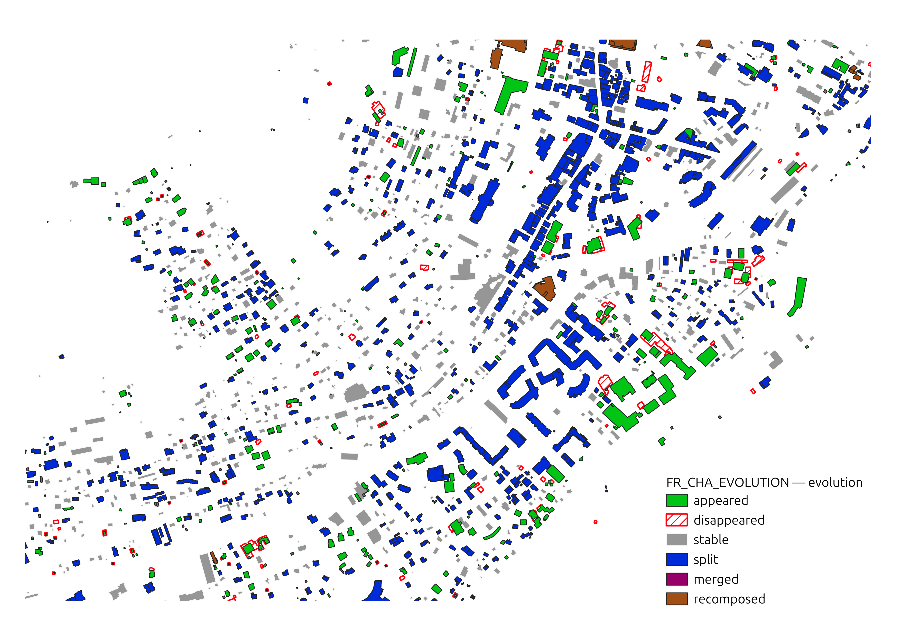

# 🐐 Cartographie du changement dans la vallée de Chamonix 🐐

Dans le cadre du projet [INTFOROUT](https://www.umr-lastig.fr/intforout/), on étudie comment produire des cartes qui rendent mieux compte de changements survenus à Chamonix.

L'analyse de l'évolution et des transformations des bâtiments repose ici sur l'exploitation des données de la BD TOPO à deux périodes différentes avec le process [ComputeBuildingChange](../Processes/ComputeBuildingChange.md)

# 🛢️ Données utilisées 🛢️

- BD TOPO 2026
- BD TOPO 2011
- ADMINEXPRESS COG CARTO PE 2026 Commune via flux WFS / OGC API Features de la géoplateforme

# 🌞 Productions 🌞

## Jeu de données

- FR-CHA-2011-26.gpkg
  - Geopackage résultat du script [matching](https://github.com/subdense/matching) qui contient les couches montrant l'évolution des batiments à Chamonix de 2011 à 2026

## Carte

_Extrait des données de l'évolution des batiments de Chamonix de 2011 à 2016_
